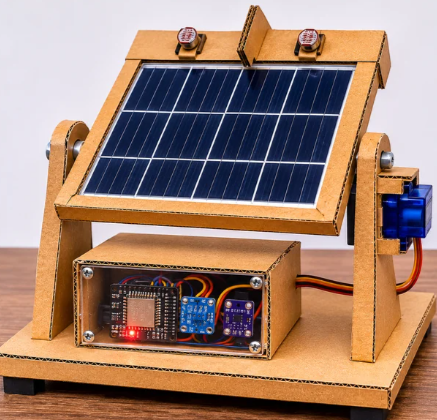

# Seguidor_solar

Prototipo electrónico de un seguidor solar automático que busca optimizar la generación de energía eléctrica mediante la orientación de un panel fotovoltaico hacia la posición de mayor aprovechamiento solar.

## Descripción general
El sistema utiliza un **ESP32**, sensores **LDR**, sensor de iluminancia **BH1750**, sensor de potencia **INA219** y un servomotor **SG90** para detectar la iluminación, medir la potencia generada y ajustar automáticamente la inclinación del panel solar.

El proyecto integra métodos numéricos como:
- **Diferencias finitas**
- **Optimización por sección áurea**
- **Regla del trapecio**

Estos métodos permiten buscar el ángulo de máxima potencia, estimar la energía producida y evaluar la eficiencia del seguimiento solar frente a un panel fijo.

## Materiales

- ESP32 DevKit V1
- Servomotor SG90
- Sensores LDR
- Sensor BH1750
- Sensor INA219
- Mini panel solar
- Resistencias de 10 kΩ
- Fuente de 5 V
- Protoboard
- Jumpers
- Soldadura

## Funcionamiento
El sistema opera a partir de un microcontrolador **ESP32** como unidad central de control y sensores ópticos **LDR** que detectan cambios de iluminación cuando el sol se desplaza. A partir de las diferencias de lectura, el sistema calcula el ajuste necesario y envía señales PWM al actuador para orientar el panel hacia la posición de mayor captación, mientras registra datos de iluminación y generación eléctrica (con apoyo del BH1750 y el INA219) y aplica métodos numéricos para analizar el rendimiento y la energía generada.

## Conexiones y estructura del repositorio

