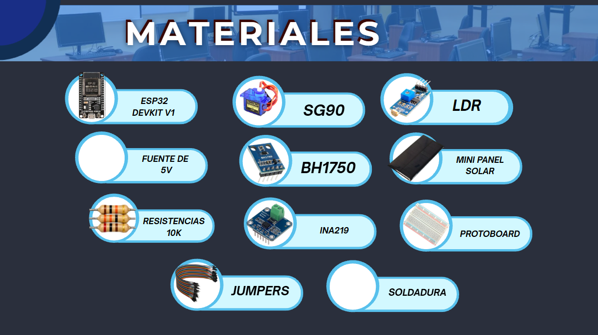
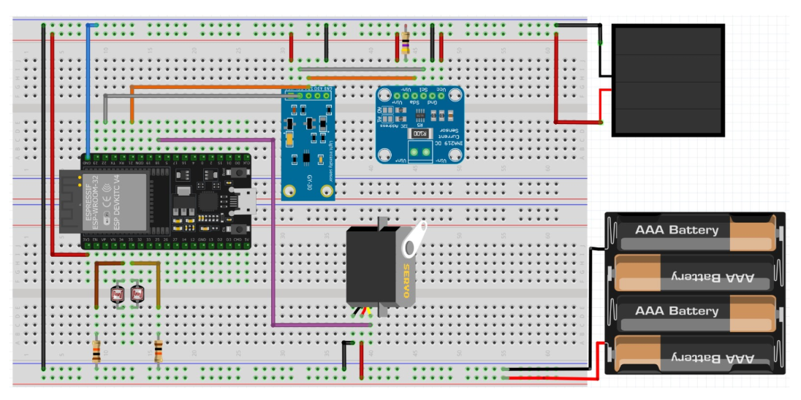

# Seguidor_solar

Prototipo electrónico de un seguidor solar automático que busca optimizar la generación de energía eléctrica mediante la orientación de un panel fotovoltaico hacia la posición de mayor aprovechamiento solar.

## Descripción general
El sistema utiliza un **ESP32**, sensores **LDR**, sensor de iluminancia **BH1750**, sensor de potencia **INA219** y un servomotor **SG90** para detectar la iluminación, medir la potencia generada y ajustar automáticamente la inclinación del panel solar.

El proyecto integra métodos numéricos como:
- **Diferencias finitas**
- **Optimización por sección áurea**
- **Regla del trapecio**

Estos métodos permiten buscar el ángulo de máxima potencia, estimar la energía producida y evaluar la eficiencia del seguimiento solar frente a un panel fijo.

## Prototipo experimental
El prototipo mide y registra cuatro magnitudes clave mediante el ESP32:
- **Tensión de bus y corriente de carga (INA219):** promedia 8 muestras consecutivas para filtrar picos transitorios y calcular la potencia real entregada ($P = V \cdot I$).
- **Iluminancia ambiental (BH1750):** mide la luz incidente en lux por I2C como referencia durante cada barrido.
- **Diferencial lumínico lateral (LDR):** lee valores analógicos de 12 bits (0 a 4095) a izquierda y derecha para detectar asimetría de sombra en tiempo real.
- **Energía acumulada y ángulo (θ y Wh):** registra el ángulo del servomotor ($20^\circ$ a $160^\circ$) e integra la potencia en el tiempo para obtener la energía en vatios-hora ($\text{Wh}$).

## Materiales

- ESP32 DevKit V1
- Servomotor SG90
- Sensores LDR
- Sensor BH1750
- Sensor INA219
- Mini panel solar
- Resistencias de 10 kΩ
- Fuente de 5 V
- Protoboard
- Jumpers
- Soldadura

## Funcionamiento
El sistema opera a partir de un microcontrolador **ESP32** como unidad central de control y sensores ópticos **LDR** que detectan cambios de iluminación cuando el sol se desplaza. A partir de las diferencias de lectura, el sistema calcula el ajuste necesario y envía señales PWM al actuador para orientar el panel hacia la posición de mayor captación, mientras registra datos de iluminación y generación eléctrica (con apoyo del BH1750 y el INA219) y aplica métodos numéricos para analizar el rendimiento y la energía generada.

## Métodos numéricos utilizados
1. **Interpolación de Lagrange:** construye una curva continua de potencia $P(\theta)$ a partir de los puntos medidos en distintos ángulos del servomotor.
2. **Interpolación de Newton (diferencias divididas):** estima valores de potencia en ángulos intermedios no medidos durante el barrido mediante diferencias escalonadas.
3. **Método de bisección:** busca raíces de $P'(\theta) = 0$ en un intervalo acotado para ubicar ángulos candidatos a máximo local.
4. **Método de Newton-Raphson:** aproxima rápidamente el punto donde se anula la derivada de la potencia ($P'(\theta) \approx 0$) usando la pendiente de la tangente.
5. **Método de la secante:** resuelve $P'(\theta) = 0$ estimando la pendiente entre dos puntos sucesivos sin requerir segunda derivada explícita.
6. **Diferencias finitas:** aproxima cómo varía la potencia respecto al ángulo de inclinación ($\mathrm{d}P/\mathrm{d}\theta$) a partir de puntos cercanos.
7. **Optimización por sección áurea:** localiza el ángulo de máxima potencia dentro del intervalo del modelo reduciendo el rango de búsqueda de forma directa.
8. **Regla del trapecio:** integra la potencia medida por el INA219 a lo largo del tiempo para calcular la energía acumulada en $\text{Wh}$.

## Conexiones y estructura del repositorio

## Código del sistema (ESP32)
Puedes ver el código a través de este enlace
[Ver código del sistema (ESP32)](https://github.com/anthonyespinoq/Seguidor_solar/blob/647f45a14f7058f9f60c126c077bcbda5d42f826/CODIGO)
